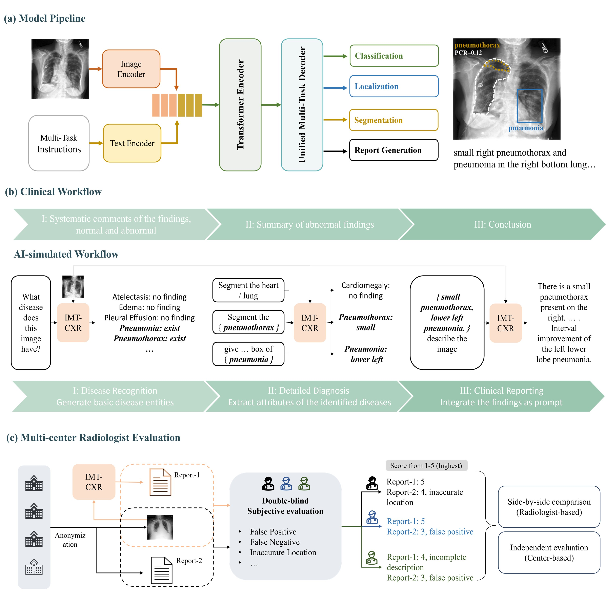
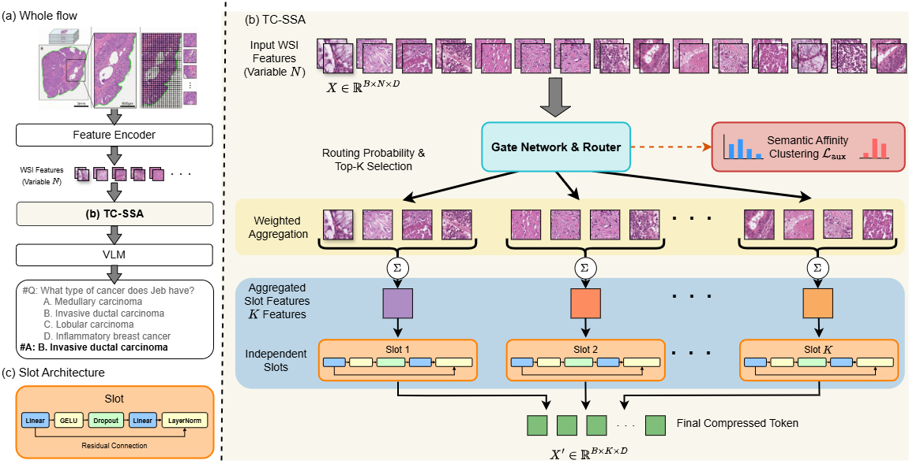

  <!-- Navigation -->
  <nav class="site-nav">
    <a class="brand" href="#home">Lijian Xu</a>

    <button
      class="nav-toggle"
      type="button"
      aria-label="Toggle navigation"
      aria-expanded="false"
      onclick="(function(b){var n=document.querySelector('#profile-site .nav-links');var o=n.classList.toggle('open');b.setAttribute('aria-expanded',String(o));})(this)"
    >☰ Menu</button>

    

      <a href="#home">Home</a>
      <a href="#research">Research</a>
      <a href="#news">News</a>
      <a href="#publications">Publications</a>
      <a href="#collaboration">Collaboration</a>
      <a href="#contact">Contact</a>
    

  </nav>

  <!-- Home -->
  <header class="hero" id="home">
    

      
Artificial Intelligence · Research

      <h1>Prof. Lijian Xu (徐利建)</h1>

      

        Associate Professor 
        Institute of Artificial Intelligence 
        Shenzhen University of Advanced Technology (SUAT)
      

      

        

          I work on multimodal artificial intelligence, efficient visual
          computing, medical foundation models, and bio-inspired embodied
          intelligence. My research aims to develop AI systems that are
          computationally efficient, generalizable, and trustworthy.
        

      

      

        <a class="action-link primary"
           href="https://scholar.google.com/citations?hl=en&user=K-PZJhkAAAAJ"
           target="_blank" rel="noopener noreferrer">Google Scholar ↗</a>

        <a class="action-link"
           href="mailto:xulijian@suat-sz.edu.cn">Email</a>

        <a class="action-link" href="#publications">Selected Publications ↓</a>
      

    

    <!-- Replace with your own portrait if available -->
    
  </header>

  <!-- Biography -->
  <section id="about">
    <h2 class="section-heading">About Me</h2>
    
Biography and research background

    

      

        Dr. Lijian Xu is an Associate Professor at the Institute of Artificial
        Intelligence, Shenzhen University of Advanced Technology (SUAT).
        He received his Ph.D. through the joint academic program of Shanghai
        Jiao Tong University and Chiba University, following his M.S. from
        Shanghai Jiao Tong University and B.S. from Zhejiang University.
      

      

        He has held research positions at The Chinese University of Hong Kong,
        Shanghai Artificial Intelligence Laboratory, and SenseTime, gaining
        experience across academic research and industrial AI development.
      

      

        His research focuses on efficient multimodal intelligence, medical AI,
        computer vision, multimodal world models, and bio-inspired embodied
        intelligence. He is particularly interested in the interplay between
        data-driven learning, structured knowledge, computational efficiency,
        and trustworthy reasoning.
      

      

        He has published over <strong>60 research papers</strong>, with work
        appearing in venues including <em>Med</em> (Cell Press), ICML,
        <em>Pattern Recognition</em>, IEEE Transactions on Medical Imaging,
        and MICCAI.
      

      

        His applied research includes contributions to the Puyi medical
        multimodal foundation model developed in collaboration with Shanghai
        AI Laboratory, medical AI infrastructure, and the deployment of AI
        systems on domestic computing platforms. He has also collaborated
        with Huawei on migration to Ascend computing platforms and contributed
        to clinical AI translation through SenseCare.
      

    

    

      

        60+
        Research Publications
      

      

        AI + Healthcare
        Research Translation
      

      

        SUAT
        Current Affiliation
      

    

  </section>

  <!-- Research -->
  <section id="research">
    <h2 class="section-heading">Research Interests</h2>
    

      From efficient multimodal models to intelligent embodied systems
    

    

      <article class="research-card">
        
⚡

        <h3>Efficient Multimodal Intelligence</h3>
        

          Reducing visual redundancy and computational cost in large
          multimodal models through token compression, dynamic inference,
          model distillation, quantization, and efficient architectures.
        

        

          Token Compression
          Efficient Inference
          Model Optimization
        

      </article>

      <article class="research-card">
        
🩺

        <h3>Medical Foundation Models</h3>
        

          Developing multimodal medical AI systems for clinical image
          understanding, computational pathology, medical report generation,
          and reliable diagnostic reasoning.
        

        

          Medical AI
          Computational Pathology
          Vision-Language Models
        

      </article>

      <article class="research-card">
        
🤖

        <h3>Embodied Intelligence &amp; World Models</h3>
        

          Exploring multimodal world models, intelligent agents, physical
          priors, and bio-inspired approaches for efficient perception,
          decision-making, and interaction with the physical world.
        

        

          World Models
          Embodied AI
          Bio-inspired Intelligence
        

      </article>

      <article class="research-card">
        
🌐

        <h3>Generalizable &amp; Trustworthy AI</h3>
        

          Improving model robustness and transparency through structured
          knowledge, open-world recognition, uncertainty estimation,
          out-of-distribution adaptation, and interpretable reasoning.
        

        

          Generalization
          Open-World Recognition
          Trustworthy AI
        

      </article>

    

  </section>

  <!-- News -->
  <section id="news">
    <h2 class="section-heading">Recent News</h2>
    
Selected research updates

    <ul class="news-list">
      <li class="news-item">
        2026
        
          Our work on interpretable multi-task chest radiograph analysis
          was published in <em>Med</em> (Cell Press).
        
      </li>

      <li class="news-item">
        2026
        
          Our work on semantic slot aggregation for gigapixel pathology
          reasoning was accepted by MICCAI 2026.
        
      </li>

      <li class="news-item">
        2026
        
          Our work on spatial-concept alignment for robust open-world vision
          appeared in <em>Pattern Recognition</em>.
        
      </li>

      <li class="news-item">
        2026
        
          Research published in <em>Journal of Crystal Growth</em>.
        
      </li>

      <li class="news-item">
        2025
        
          Research accepted by ICML 2025 and published in
          IEEE Transactions on Medical Imaging.
        
      </li>
    </ul>
  </section>

  <!-- Publications -->
  <section id="publications">
    <h2 class="section-heading">Selected Publications</h2>
    

      A selection of recent work. For the full publication list, please visit
      <a href="https://scholar.google.com/citations?hl=en&user=K-PZJhkAAAAJ"
         target="_blank" rel="noopener noreferrer">Google Scholar ↗</a>.
    

    

      

        <button class="filter-btn active" data-year="all" type="button">All</button>
        <button class="filter-btn" data-year="2026" type="button">2026</button>
        <button class="filter-btn" data-year="2025" type="button">2025</button>
      

      
        4 selected publications
      
    

    

      <!-- Med 2026 -->
      <article class="pub-card" data-year="2026">
        

          
        

        

          Med · Cell Press · 2026
          <h3 class="pub-title">
            A unified multi-task framework enables interpretable chest
            radiograph analysis
          </h3>
          

            <strong>Lijian Xu</strong>, Ziyu Ni, Xinglong Liu, Xiaosong Wang,
            Hongsheng Li, Shaoting Zhang
          

          

            Medical AI · Multi-task Learning · Interpretable Diagnosis
          

          

            <a href="https://arxiv.org/abs/2606.03417"
               target="_blank" rel="noopener noreferrer">Paper ↗</a>
          

        

      </article>

      <!-- Pattern Recognition 2026 -->
      <article class="pub-card" data-year="2026">
        

          
        

        

          Pattern Recognition · 2026
          <h3 class="pub-title">
            SCALAR: Spatial-Concept Alignment for Robust Vision in Harsh
            Open World
          </h3>
          

            Xiaoyu Yang, <strong>Lijian Xu</strong>, Xingyu Zeng, Xiaosong Wang,
            Hongsheng Li, Shaoting Zhang
          

          

            Computer Vision · Spatial-Concept Alignment · Open-World Recognition
          

          

            <a href="https://www.sciencedirect.com/science/article/pii/S0031320326001688"
               target="_blank" rel="noopener noreferrer">Paper ↗</a>
          

        

      </article>

      <!-- MICCAI 2026 -->
      <article class="pub-card" data-year="2026">
        

          
        

        

          MICCAI · 2026
          <h3 class="pub-title">
            TC-SSA: Token Compression via Semantic Slot Aggregation for
            Gigapixel Pathology Reasoning
          </h3>
          

            Zhuo Chen, Xiaoyu Yang, <strong>Lijian Xu</strong>
          

          

            Computational Pathology · Token Compression · Efficient Reasoning
          

          

            <a href="https://arxiv.org/pdf/2603.01143"
               target="_blank" rel="noopener noreferrer">Paper ↗</a>
          

        

      </article>

      <!-- IEEE TMI 2025 -->
      <article class="pub-card" data-year="2025">
        

          
        

        

          IEEE Transactions on Medical Imaging · 2025
          <h3 class="pub-title">
            Segmentation and Vascular Vectorization for Coronary Artery by
            Geometry-Based Cascaded Neural Network
          </h3>
          

            Xiaoyu Yang, <strong>Lijian Xu</strong>, Qing Xia, Simon C. H. Yu,
            Hongsheng Li, Shaoting Zhang
          

          

            Medical Image Analysis · Coronary Artery Segmentation · Vectorization
          

          

            <a href="https://arxiv.org/pdf/2305.04208"
               target="_blank" rel="noopener noreferrer">Paper ↗</a>
          

        

      </article>

    

    

      <a class="action-link"
         href="https://scholar.google.com/citations?hl=en&user=K-PZJhkAAAAJ"
         target="_blank" rel="noopener noreferrer">
        View Full Publication List on Google Scholar ↗
      </a>
    

  </section>

  <!-- Collaboration -->
  <section id="collaboration">
    <h2 class="section-heading">Collaboration</h2>
    

      Research collaboration across AI, medicine, and intelligent systems
    

    

      

        <strong>Medical Foundation Models</strong> 
        
          Multimodal learning and clinical reasoning
        
      

      

        <strong>Computational Pathology</strong> 
        
          Whole-slide image understanding and efficient inference
        
      

      

        <strong>Vision-Language Intelligence</strong> 
        
          Multimodal reasoning and generalizable visual models
        
      

      

        <strong>Embodied Intelligence</strong> 
        
          World models and bio-inspired intelligent systems
        
      

    

  </section>

  <!-- Contact -->
  <section id="contact">
    <h2 class="section-heading">Contact</h2>
    

      Academic collaboration, student opportunities, and research inquiries
    

    

      

        I welcome opportunities for academic and industry collaboration
        in multimodal AI, medical AI, efficient visual computing, and
        embodied intelligence.
      

      

        <strong>Email:</strong>
        <a href="mailto:xulijian@suat-sz.edu.cn">
          xulijian@suat-sz.edu.cn
        </a>
      

      

        <strong>Affiliation:</strong> 
        Institute of Artificial Intelligence, 
        Shenzhen University of Advanced Technology (SUAT)
      

      

        <a href="https://scholar.google.com/citations?hl=en&user=K-PZJhkAAAAJ"
           target="_blank" rel="noopener noreferrer">
          Google Scholar ↗
        </a>
      

    

  </section>

  <footer class="site-footer">
    <a class="back-top" href="#home">Back to top ↑</a>
    © 2026 Lijian Xu · Shenzhen University of Advanced Technology
  </footer>

